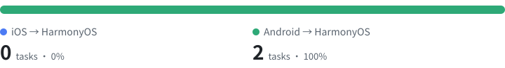

<div align="center">

# Efflora HarmonyOS Migration Bench

**An open-source benchmark for evaluating coding agents on migrating iOS / Android apps to HarmonyOS**

[](LICENSE)
[](https://docs.harborframework.com/tasks/overview)
[](https://huggingface.co/datasets/efflora/harmonyos-migration-bench-runs)

English | [简体中文](README.md)

**📦 Trajectories & artifacts: [Hugging Face dataset](https://huggingface.co/datasets/efflora/harmonyos-migration-bench-runs)**

</div>

---

## Overview

**Efflora HarmonyOS Migration Bench** is an open-source benchmark for HarmonyOS app migration, started by Efflora. It evaluates the end-to-end ability of AI coding agents to **migrate real-world apps from other mobile stacks to HarmonyOS**.

Many existing apps need to move from iOS / Android to HarmonyOS, yet existing coding benchmarks barely cover cross-stack migration. This benchmark sets out to answer one question:

> Given a real iOS / Android project and a migration brief, can an agent migrate the app the way a competent HarmonyOS engineer would, and deliver a functionally equivalent HarmonyOS project that is ready for production?

Every task follows the [Harbor Framework](https://docs.harborframework.com) task format, so any agent/model supported by the `harbor` CLI can be evaluated out of the box.

## Task Categories



Every task is a Harbor task: inside a container the agent gets the source-platform project to migrate (`/workspace/source`), a HarmonyOS project or scaffold (`/workspace/app`) and a migration brief (`instruction.md`). Afterwards, hidden tests build the project, run UI tests on an emulator, and assign a reward. The two categories differ in the source platform:

| Category | Task id prefix | Source project | Scoring |
| --- | --- | --- | --- |
| **iOS → HarmonyOS** | `ios2hm-` | iOS project (SwiftUI / UIKit) | Fraction of migration acceptance checks (F-points) passed |
| **Android → HarmonyOS** | `android2hm-` | Android project (Compose / View) | Fraction of migration acceptance checks (F-points) passed |

The full task list is in the [task index](tasks/index.jsonl).

See [task categories and authoring guidelines](docs/categories.md) for detailed definitions and requirements.

## Environment Requirements

All tasks, reference solutions and tests target the following environment (see [environment requirements](docs/environment.md)):

| Item | Value |
| --- | --- |
| OS version | HarmonyOS 6.1.1(24) |
| API level | 24 |
| Device | Pura 90 Pro |
| Resolution | 1256 × 2760 |
| Time zone | Asia/Shanghai |
| Locale | zh-Hans-CN |
| Harbor | 0.24.0 (`schema_version = "1.4"` in `task.toml`) |

## Repository Layout

```text
efflora-harmonyos-migration-bench/
├── tasks/                       # Tasks (Harbor format), flat; category determined by task id prefix
│   ├── index.jsonl               # Task index, one task per line (generated by scripts/build_index.py)
│   └── <task-id>/                # One self-contained directory per task, e.g. android2hm-catima-full-app
│       ├── instruction.md        # Task instructions for the agent
│       ├── task.toml             # Task configuration and metadata
│       ├── environment/          # Dockerfile and build context (HarmonyOS scaffold, etc.; the source-platform project is fetched at build time)
│       ├── solution/             # Reference solution (solve.sh) to verify task solvability
│       └── tests/                # Verification scripts (test.sh), hidden from the agent during execution
├── assets/                      # Task distribution chart in the README (generated by scripts/build_index.py)
├── docker/
│   └── harmonyos-base/           # Build files for efflora/harmonyos-base (download the toolchain separately)
├── scripts/
│   ├── build_index.py            # Generate tasks/index.jsonl and the task distribution chart
│   ├── check_emulator.sh         # Preflight check of the emulator before an evaluation run
│   ├── validate_tasks.py         # Validate task structure and metadata
│   └── validate_submission.py    # Validate evaluation submissions (Harbor job directories)
├── docs/
│   ├── categories.md             # Category definitions and task authoring guidelines
│   ├── environment.md            # Environment requirements (OS / device / time zone / locale / Harbor version)
│   ├── task-format.md            # Harbor task format conventions used in this benchmark
│   ├── emulator-ui-tests.md      # Emulator setup and integration
│   └── evaluation.md             # Evaluation workflow, metrics and result submission
├── CITATION.cff                  # Citation metadata
├── CONTRIBUTING.md
├── NOTICE
└── LICENSE
```

## Quick Start

### 1. Prepare the Environment

- Docker (at least 4 CPUs and 8 GB of memory recommended)
- [Harbor CLI](https://docs.harborframework.com) **0.24.0**: `uv tool install harbor==0.24.0` (or `pip install harbor==0.24.0`)
- Task base image `efflora/harmonyos-base:latest`: download the HarmonyOS command-line tools `commandline-tools-linux-x64-6.1.1.418.zip` (Command Line Tools 6.1.1 Release, bundled API 24 SDK; the build script checks its SHA-256), then build locally with the [build script](docker/harmonyos-base/build.sh); see the [base image guide](docker/harmonyos-base/README.md)
- Tasks with emulator UI tests (those whose `tests/fpoints.json` defines F-points) also require a HarmonyOS emulator meeting the environment requirements (on a macOS or Linux host), with the `EFFLORA_DEVICE_SN` environment variable set and checked by the [emulator preflight script](scripts/check_emulator.sh); see [emulator setup and integration](docs/emulator-ui-tests.md)

### 2. Verify Task Solvability (Oracle)

```bash
harbor run -p tasks -a oracle
```

### 3. Evaluate an Agent

```bash
# Evaluate all tasks
harbor run -p tasks -a claude-code -m anthropic/claude-opus-5-5

# Evaluate one category (filter by task id prefix)
harbor run -p tasks -i 'android2hm-*' -a claude-code -m anthropic/claude-opus-5-5

# Evaluate one task
harbor run -p tasks/android2hm-catima-full-app -a claude-code -m anthropic/claude-opus-5-5
```

Results are written to `jobs/` by default. See the [evaluation guide](docs/evaluation.md) for metrics and result submission.

## Evaluation Principles

- **Real-world projects**: Source projects come from real open-source iOS / Android apps, and migrations are verified against the source app's behavior.
- **Executable verification**: Evaluation relies on successful builds and hidden tests, with LLM scoring excluded as the primary metric.
- **Reproducibility**: Upstream code is pinned to specific commits, image versions are fixed, and reference solutions must pass all checks.
- **Leakage prevention**: `tests/` and `solution/` are hidden from the agent during execution.

## Contributing

Contributions of new tasks, evaluation environment improvements and issue reports are welcome! Please read the [contributing guide](CONTRIBUTING.md) first.

## License

Code, task instructions and tests are licensed under [Apache-2.0](LICENSE). Third-party upstream projects used by tasks (the iOS / Android source apps, fetched at build time) keep their original licenses (see each task's `metadata.upstream_license` and [NOTICE](NOTICE)); reference solutions (`solution/`) ported from such a project follow that project's license (e.g. GPL-3.0), see [NOTICE](NOTICE). The HarmonyOS SDK is governed by Huawei's own terms and is not distributed here.

## Citation

```bibtex
@misc{efflora-harmonyos-migration-bench,
  title  = {Efflora HarmonyOS Migration Bench: Benchmarking Coding Agents on Migrating Mobile Apps to HarmonyOS},
  author = {Efflora},
  year   = {2026},
  url    = {https://github.com/Equality-Machine/efflora-harmonyos-migration-bench}
}
```

## Acknowledgments

The design of this benchmark draws on excellent open-source projects including [Harbor Framework](https://github.com/laude-institute/harbor), [Terminal-Bench](https://github.com/laude-institute/terminal-bench) and [SWE-bench](https://github.com/SWE-bench/SWE-bench).
