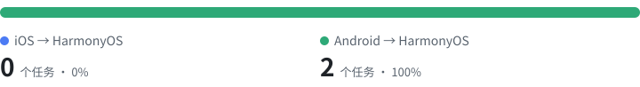

<div align="center">

# Efflora HarmonyOS Migration Bench

**面向「iOS / Android → HarmonyOS」应用迁移的开源 Coding Agent 评测基准**

[](LICENSE)
[](https://docs.harborframework.com/tasks/overview)
[](https://huggingface.co/datasets/efflora/harmonyos-migration-bench-runs)

[English](README.en.md) | 简体中文

**📦 运行轨迹与产物下载：[Hugging Face 数据集](https://huggingface.co/datasets/efflora/harmonyos-migration-bench-runs)**

</div>

---

## 简介

**Efflora HarmonyOS Migration Bench** 是由 Efflora 发起的开源鸿蒙应用迁移测评的 Benchmark，用于评估 AI Coding Agent 将**其他移动端技术栈的真实应用迁移到 HarmonyOS** 的端到端能力。

大量存量应用需要从 iOS / Android 迁移到鸿蒙，但现有 coding benchmark 几乎没有覆盖“跨技术栈迁移”这一场景。本Benchmark希望回答一个问题：

> 给 Agent 一个真实的 iOS / Android 工程和一份迁移要求，它能否像一名合格的鸿蒙工程师一样，把应用迁移为功能等价、可以直接用于生产的 HarmonyOS 工程？

所有任务采用 [Harbor Framework](https://docs.harborframework.com) 任务格式，可直接用 `harbor` CLI 对任意 Agent / 模型进行评测。

## 任务分类



每个任务都是一个 Harbor 任务：Agent 在容器中拿到待迁移的源平台工程（`/workspace/source`）、鸿蒙工程或脚手架（`/workspace/app`）和一份迁移要求（`instruction.md`），完成后由隐藏测试编译工程，在模拟器上运行 UI 测试并打分。两类任务的区别在于源平台：

| 分类 | 任务 id 前缀 | 源工程 | 计分 |
| --- | --- | --- | --- |
| **iOS → HarmonyOS** | `ios2hm-` | iOS 工程（SwiftUI / UIKit） | 按通过的迁移验收点（F-point）比例给分 |
| **Android → HarmonyOS** | `android2hm-` | Android 工程（Compose / View） | 按通过的迁移验收点（F-point）比例给分 |

完整任务清单见[任务索引](tasks/index.jsonl)。

各分类的详细定义与出题要求见[任务分类与出题规范](docs/categories.md)。

## 环境约定

所有任务的出题、参考解与测试均以下列环境为准（详见[环境约定](docs/environment.md)）：

| 项 | 约定值 |
| --- | --- |
| 系统版本 | HarmonyOS 6.1.1(24) |
| 系统 API 版本 | 24 |
| 设备型号 | Pura 90 Pro |
| 分辨率 | 1256 × 2760 |
| 时区 | Asia/Shanghai |
| 语言 | zh-Hans-CN |
| Harbor | 0.24.0（`task.toml` 的 `schema_version = "1.4"`） |

## 仓库结构

```text
efflora-harmonyos-migration-bench/
├── tasks/                       # 任务（Harbor 格式），所有任务平铺，分类由任务 id 前缀区分
│   ├── index.jsonl              # 任务索引（每行一个任务，由 scripts/build_index.py 生成）
│   └── <task-id>/               # 每个任务一个自包含目录，如 android2hm-catima-full-app
│       ├── instruction.md       # 给 Agent 的任务说明
│       ├── task.toml            # 任务配置与元数据
│       ├── environment/         # Dockerfile 及构建上下文（鸿蒙脚手架等；源平台工程在构建时拉取）
│       ├── solution/            # 参考解（solve.sh），用于校验任务可解
│       └── tests/               # 验证脚本（test.sh），Agent 运行时不可见
├── assets/                      # README 中的任务分布图（由 scripts/build_index.py 生成）
├── docker/
│   └── harmonyos-base/          # 任务基础镜像 efflora/harmonyos-base 的构建文件（工具链需自行下载）
├── scripts/
│   ├── build_index.py           # 生成 tasks/index.jsonl 和任务分布图
│   ├── check_emulator.sh        # 运行评测前预检模拟器接入
│   ├── validate_tasks.py        # 校验任务结构与元数据
│   └── validate_submission.py   # 校验评测提交（Harbor job 目录）
├── docs/
│   ├── categories.md            # 分类定义与出题规范
│   ├── environment.md           # 环境约定（系统 / 设备 / 时区 / 语言 / Harbor 版本）
│   ├── task-format.md           # Harbor 任务格式在本基准中的约定
│   ├── emulator-ui-tests.md     # 模拟器的配置与接入
│   └── evaluation.md            # 评测流程、指标与结果提交
├── CITATION.cff                 # 引用元数据
├── CONTRIBUTING.md
├── NOTICE
└── LICENSE
```

## 快速开始

### 1. 准备环境

- Docker（建议分配 ≥ 4 CPU / 8 GB 内存）
- [Harbor CLI](https://docs.harborframework.com) **0.24.0**：`uv tool install harbor==0.24.0`（或 `pip install harbor==0.24.0`）
- 任务基础镜像 `efflora/harmonyos-base:latest`：自行下载 HarmonyOS 命令行工具链 `commandline-tools-linux-x64-6.1.1.418.zip`（Command Line Tools 6.1.1 Release，内置 API 24 SDK；构建脚本会校验 SHA-256）后，执行[构建脚本](docker/harmonyos-base/build.sh)在本地构建，见[基础镜像说明](docker/harmonyos-base/README.md)
- 含模拟器 UI 测试的任务（`tests/fpoints.json` 中定义 F-point 的任务）还需要一台符合环境要求的 HarmonyOS 模拟器（macOS 或 Linux 宿主机），并设置 `EFFLORA_DEVICE_SN`、用[模拟器预检脚本](scripts/check_emulator.sh)预检，见[模拟器配置与接入](docs/emulator-ui-tests.md)

### 2. 校验任务可解（Oracle）

```bash
harbor run -p tasks -a oracle
```

### 3. 评测一个 Agent

```bash
# 评测全部任务
harbor run -p tasks -a claude-code -m anthropic/claude-opus-5-5

# 评测单个分类（按任务 id 前缀筛选）
harbor run -p tasks -i 'android2hm-*' -a claude-code -m anthropic/claude-opus-5-5

# 评测单个任务
harbor run -p tasks/android2hm-catima-full-app -a claude-code -m anthropic/claude-opus-5-5
```

结果默认写入 `jobs/` 目录。评测指标与结果提交方式见[评测说明](docs/evaluation.md)。

## 评测原则

- **真实工程**：源工程来自真实的 iOS / Android 开源项目，按源应用的行为验证迁移结果。
- **可执行验证**：以编译通过 + 隐藏测试为准，不依赖 LLM 打分作为主指标。
- **可复现**：上游代码固定到具体 commit，镜像版本固定，参考解必须 100% 通过。
- **防泄漏**：`tests/` 与 `solution/` 在 Agent 运行时不可见。

## 贡献

欢迎贡献新任务、改进评测环境或报告问题！请先阅读[贡献指南](CONTRIBUTING.md)。

## 许可证

本仓库代码、任务说明与测试脚本采用 [Apache License 2.0](LICENSE) 授权。

任务中引用的**第三方上游项目**（待迁移的 iOS / Android 源工程，在构建时拉取）保留其原始许可证，具体见各任务 `task.toml` 中的 `metadata.upstream_license` 字段及 [NOTICE](NOTICE)。参考解（`solution/`）由上游源工程移植而来时，遵循上游项目的许可证（如 GPL-3.0），见 [NOTICE](NOTICE)。HarmonyOS SDK 及相关工具受华为相应许可协议约束，不随本仓库分发。

## 引用

```bibtex
@misc{efflora-harmonyos-migration-bench,
  title  = {Efflora HarmonyOS Migration Bench: Benchmarking Coding Agents on Migrating Mobile Apps to HarmonyOS},
  author = {Efflora},
  year   = {2026},
  url    = {https://github.com/Equality-Machine/efflora-harmonyos-migration-bench}
}
```

## 致谢

本Benchmark的设计参考了 [Harbor Framework](https://github.com/laude-institute/harbor)、[Terminal-Bench](https://github.com/laude-institute/terminal-bench)、[SWE-bench](https://github.com/SWE-bench/SWE-bench) 等优秀开源项目。
